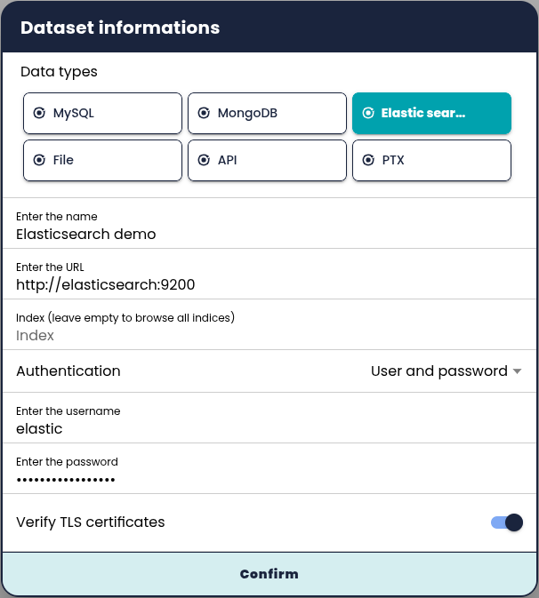
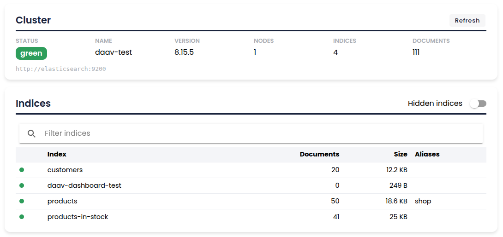
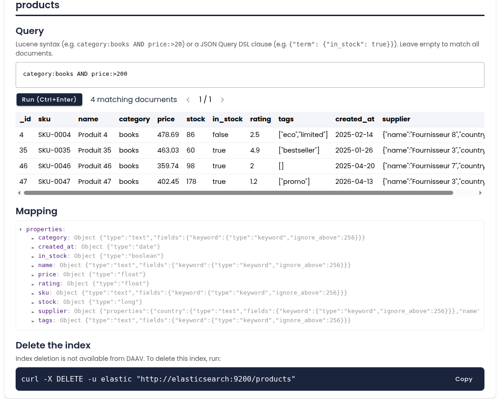
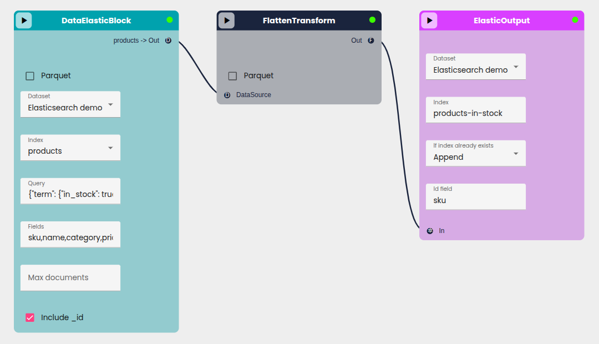

# Elasticsearch

DAAV connects to Elasticsearch clusters (8.x) to:

- explore a cluster and its indices from the dataset dashboard,
- read the documents of an index in a workflow (**DataElasticBlock**),
- write the result of a workflow into an index (**ElasticOutput**).

## Connect a cluster

In **Datasets**, click **Add dataset** and choose **Elastic search**.



| Field | Description |
|-------|-------------|
| Name | Name of the dataset in DAAV |
| URL | Cluster URL, e.g. `https://my-cluster.example.com:9200` |
| Index | Optional. Fixes the index used by the dataset. Leave empty to browse all the indices visible with the credentials and pick one in each node |
| Authentication | `None`, `User and password`, `API key` or `Bearer token` |
| Verify TLS certificates | Disable only for a test cluster with a self-signed certificate |

**Authentication**

- **API key** (recommended): paste the `encoded` value returned by Elasticsearch when the key is created (see below).
- **Bearer token**: an OAuth2 access token. Elasticsearch only issues these tokens over HTTPS.
- Passwords, API keys and tokens are encrypted in the DAAV database and never sent back to the browser. When editing a dataset, leave the secret fields empty to keep the stored credentials. Changing the authentication mode clears the credentials of the other modes.

**Privileges.** Give the credentials only what you use:

| Feature | Index privileges | Cluster privileges |
|---------|------------------|--------------------|
| Dashboard, Render tab, DataElasticBlock | `read`, `view_index_metadata`, `monitor` | `monitor` (optional, shows the cluster health) |
| ElasticOutput | `create_index`, `write`, plus `delete_index` for the *Replace* option | — |
| Index creation from the dashboard | `create_index` | — |

Example: a read-only API key for two indices.

```bash
curl -u elastic -X POST "https://my-cluster.example.com:9200/_security/api_key" \
  -H 'Content-Type: application/json' -d '{
    "name": "daav-read",
    "role_descriptors": {
      "daav": {
        "cluster": ["monitor"],
        "indices": [{"names": ["products", "customers"], "privileges": ["read", "view_index_metadata", "monitor"]}]
      }
    }
  }'
```

**Private networks.** To protect the server against SSRF, DAAV refuses URLs that point to `localhost` or to a private or internal address. The hostname is resolved before each connection. To connect to a cluster on the same private network (e.g. the `elasticsearch` service of Docker Compose), add its hostname to `ALLOWED_PRIVATE_HOSTS` in `backendApi/.env`:

```bash
ALLOWED_PRIVATE_HOSTS=elasticsearch
```

## Explore the cluster

Select the dataset, then the **Render** tab: the **Informations** tab is the Elasticsearch dashboard.



- **Cluster**: health, name, version, number of nodes, indices and documents. **Refresh** reloads everything.
- **Indices**: document count, size and aliases of each index. The filter matches index names and aliases; **Hidden indices** also lists system indices.

Click an index to open its details:



- **Query**: a Lucene query (`category:books AND price:>200`) or a JSON Query DSL clause (`{"term": {"in_stock": true}}`). Leave it empty to list all documents. Results are paginated by 20 (`Ctrl+Enter` runs the query).
- **Mapping**: the index mapping, as an expandable tree.
- **Delete the index**: deletion is not available from DAAV. The dashboard gives the `curl` command to run instead, without any secret.
- **Create an index** (dataset owner or administrator): name and optional mappings, e.g. `{"properties": {"title": {"type": "text"}, "price": {"type": "double"}}}`.

The **Datasets** tab next to **Informations** shows the documents of an index as a table, like for the other data sources.

## Read an index in a workflow

Add a **DataElasticBlock** node, select the dataset, then the index (only when the dataset does not fix one).

| Control | Description |
|---------|-------------|
| Query | Optional. Lucene query or JSON Query DSL clause (also accepted wrapped in `{"query": ...}`). Empty reads all documents |
| Fields | Optional. Comma-separated list of the fields to keep, e.g. `sku,name,price,supplier`. Empty keeps whole documents |
| Max documents | Optional. Stops after this number of documents. Empty reads the whole result |
| Include _id | Adds the document id as an `_id` column |

The output preview (and so the schema offered to the next nodes) is refreshed after you type. Nested objects and arrays are kept as they are: add a **FlattenTransform** node to get flat columns (`supplier.name` becomes `supplier_name`).

When the node runs on the sample, it reads the first 20 documents. A full run reads all the matching documents with a point in time and `search_after`, so it is not limited to the 10,000 results of a regular search.

## Write to an index

Add an **ElasticOutput** node and connect its input. It accepts nested data as well as flat data, e.g. after a Flatten node.

| Control | Description |
|---------|-------------|
| Dataset | Elasticsearch dataset to write to |
| Index | Existing indices are suggested; a new name creates the index. Lowercase letters, digits, `-`, `_` and `.` |
| If index already exists | `Fail` (default), `Replace` (the index is deleted and created again) or `Append` |
| Id field | Optional. Column used as document id. Documents with an existing id are replaced, so running the workflow again updates them instead of creating duplicates. Empty: ids are generated by Elasticsearch |

- A new index gets explicit mappings for numeric, boolean and date columns; other columns use Elasticsearch dynamic mapping.
- An `_id` column (e.g. from a DataElasticBlock with *Include _id*) is never stored in the documents, as `_id` is reserved by Elasticsearch. Use `_id` as **Id field** to keep these ids.
- Documents rejected by Elasticsearch (e.g. a value that does not match the mapping) put the node in error, with the number of rejected documents and the first reasons.
- Like the other outputs, running the node on the sample writes the sample (20 documents).
- The node status message gives the number of indexed documents.

## Example: copy the products in stock



1. **DataElasticBlock**: index `products`, query `{"term": {"in_stock": true}}`, fields `sku,name,category,price,supplier`.
2. **FlattenTransform**: turns `supplier` into `supplier_name` and `supplier_country`.
3. **ElasticOutput**: index `products-in-stock`, *Append*, id field `sku`.

Running the workflow (▶ next to the workflow name) creates `products-in-stock` with one document per product in stock. Running it again updates the same documents.

## Local test cluster

`docker-compose.yml` includes an Elasticsearch node in the `elastic` profile, published on `127.0.0.1:9200` only:

```bash
# Start the node (choose a password)
ELASTIC_PASSWORD=<password> docker-compose --profile elastic up -d

# Load the sample indices: products (50 documents) and customers (20 documents)
ES_PASSWORD=<password> docs/test-files/elasticsearch/seed.sh
```

From the DAAV backend container, the URL is `http://elasticsearch:9200`: add `ALLOWED_PRIVATE_HOSTS=elasticsearch` to `backendApi/.env`.

The backend integration tests run against such a node:

```bash
cd backendApi
ES_TEST_URL=http://localhost:9200 ES_TEST_USER=elastic ES_TEST_PASSWORD=<password> pytest tests/integration
```

## Troubleshooting

| Message | Cause and fix |
|---------|---------------|
| `'url' must not point to localhost` / `resolves to a private or internal address` | The cluster is on a private network: add its hostname to `ALLOWED_PRIVATE_HOSTS` |
| `Cannot reach Elasticsearch at ...` | Wrong URL or port, cluster down, or network/firewall issue between the DAAV backend and the cluster |
| `Elasticsearch authentication failed` | Wrong user, password, API key or token |
| `Elasticsearch refused the action: ... granted by the index privileges [...]` | The credentials lack a privilege: add the privilege named in the message (see *Privileges*) |
| `Invalid JSON query` / `The query must contain exactly one clause` | Fix the JSON, or use a single clause such as `{"bool": {...}}` |
| `Result window is too large` | Dashboard or Render tab pages beyond 10,000 results: refine the query. Workflow nodes are not limited |
| `Index '...' already exists and ifExist is set to 'fail'` | Choose *Append* or *Replace* in the ElasticOutput node |
| `N documents were rejected by Elasticsearch` | Values that do not match the index mapping: fix the data (e.g. with a transform) or the mapping |
